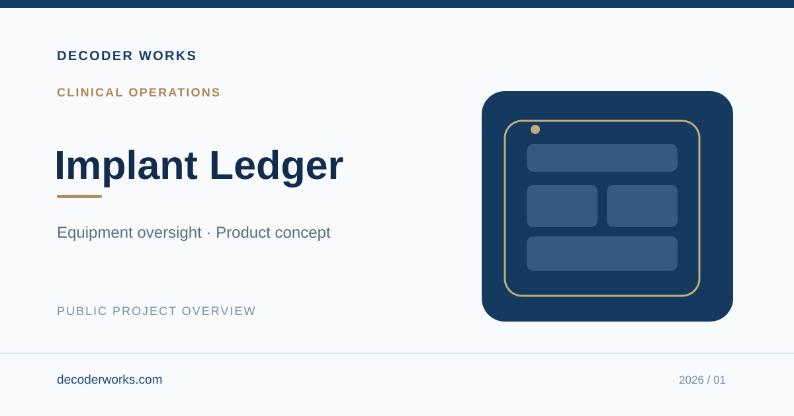

# Implant Ledger

**Clinical Operations · Product Concept & Development**

A digital product designed to bring greater clarity and consistency to the management of shared clinical equipment.

## Key Use Cases

- Improve visibility into the condition and readiness of shared clinical equipment.
- Support consistent oversight and accountability across teams.
- Reduce uncertainty in day-to-day equipment management.

## My Contribution

Project concept, problem definition, product direction, user experience design, and prototype development.

## Project Access

**Portfolio:** Public overview only  
**Working application:** Private  
**Source code:** Not publicly available

This portfolio intentionally excludes implementation details, proprietary workflows, business logic, database structures, and confidential or institutional information. The cover is an illustrative design, not an application screenshot.

## More Information

**Website:** [decoderworks.com](https://decoderworks.com)  
**Email:** [info@decoderworks.com](mailto:info@decoderworks.com)

---

*© 2026 Decoder Works. Public portfolio summary only. No software license is granted. This page documents development contributions and does not determine contractual or institutional intellectual-property rights.*
